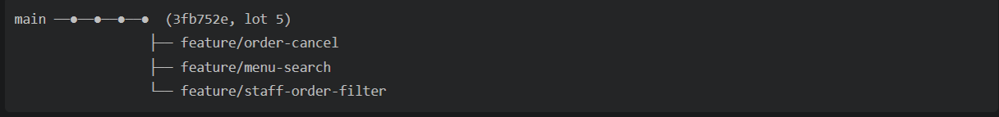

# branches_specs — 3 features, 3 branches

Règles communes (voir `CLAUDE.md`) :
- JavaScript uniquement, aucune nouvelle dépendance, projet minimaliste.
- Une feature à la fois. Chaque branche part de `main` à jour.
- Je ne lance aucune commande git qui modifie le dépôt : l'utilisateur crée les branches, commit et push.
- À la fin de chaque feature : vérifier chaque critère (OK / partiel / manquant), lancer le build, donner la checklist, comment tester et un message de commit, puis attendre le feu vert.
- Statuts existants des commandes : `recue`, `en_preparation`, `prete`.

Schéma des branches :

```
main ──●──●──●  (3fb752e, lot 5)
         ├── feature/order-cancel
         ├── feature/menu-search
         └── feature/staff-order-filter
```

---

## 1. `feature/order-cancel`

**But :** le client peut annuler sa commande tant que le staff ne l'a pas prise en charge.

**Specs**
- Une commande est annulable uniquement si son statut est `recue`.
- Nouveau statut `annulee`.
- Seul le client propriétaire de la commande peut l'annuler.

**Backend**
- `server/src/db/schema.sql` : ajouter `annulee` à la contrainte `CHECK` du statut. Fournir le `ALTER TABLE` à exécuter sur la base existante.
- `PATCH /api/orders/:id/cancel`, avec `requireAuth` et `requireRole("client")`.
  - Commande inexistante ou appartenant à un autre client : 404 `{ error: "Commande introuvable." }`.
  - Statut différent de `recue` : 400 `{ error: "Commande non annulable." }`.
  - Succès : 200 avec la commande publique (même forme que `toPublicOrder`), statut `annulee`.
- Le staff ne peut plus faire avancer une commande `annulee` (400 dans `updateOrderStatus`).

**Frontend**
- `MyOrdersPage` : bouton « Annuler » visible uniquement si statut `recue`.
- Afficher le statut `annulee` (libellé « Annulée »).
- `StaffDashboardPage` : afficher le statut `annulee` sans bouton de changement.

**Critères d'acceptation**
- Annuler une commande `recue` fonctionne et met à jour l'affichage.
- Annuler une commande `en_preparation` ou `prete` est refusé (400).
- Un client ne peut pas annuler la commande d'un autre (404).
- Le staff ne peut pas modifier une commande annulée.

---

## 2. `feature/menu-search`

**But :** trouver un plat plus vite sur la page Menu.

**Specs**
- Champ de recherche par nom, insensible à la casse.
- Filtre par catégorie (« Toutes » par défaut).
- Les deux filtres se combinent.
- Message « Aucun plat trouvé » si le résultat est vide.

**Frontend uniquement**
- `MenuPage` : filtrage côté client sur les données déjà chargées. Pas de nouvelle route, pas de librairie.

**Critères d'acceptation**
- Taper une partie du nom filtre la liste en direct.
- Choisir une catégorie filtre la liste.
- Recherche et catégorie fonctionnent ensemble.
- Le panier n'est pas affecté par les filtres.

---

## 3. `feature/staff-order-filter`

**But :** le staff voit rapidement les commandes à traiter.

**Specs**
- Boutons de filtre : Toutes / Reçue / En préparation / Prête.
- Compteur de commandes à côté de chaque filtre.
- Filtre « Toutes » par défaut.

**Frontend uniquement**
- `StaffDashboardPage` : filtrage et compteurs calculés côté client à partir de la liste déjà chargée. Pas de changement d'API.

**Critères d'acceptation**
- Chaque filtre n'affiche que les commandes du statut choisi.
- Les compteurs sont corrects et se mettent à jour après un changement de statut.
- Le changement de statut continue de fonctionner quand un filtre est actif.

> Si `feature/order-cancel` est mergée avant, ajouter un filtre « Annulée » dans cette branche.

---

## Étapes de travail (pour chaque feature)

1. L'utilisateur : `git checkout main`, `git pull`, `git checkout -b <nom-de-branche>`.
2. Je code uniquement le périmètre de la feature.
3. Je lance le build et je vérifie chaque critère.
4. Je donne la checklist, comment tester et un message de commit.
5. L'utilisateur teste, commit et push la branche.
6. J'attends le feu vert avant la feature suivante.


## Schéma des branches


